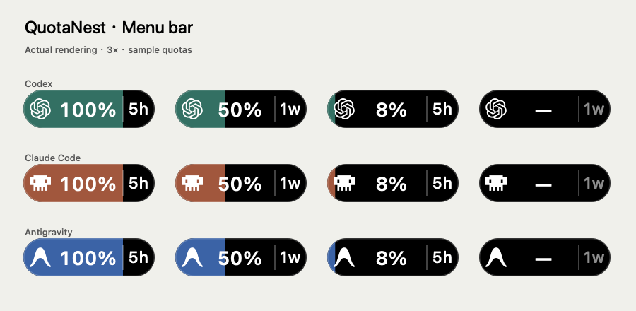

<p align="center"></p>
<h1 align="center">余度 QuotaNest</h1>
<p align="center"><b>所有 AI 余量，一眼有数。</b><br>AI subscription quotas, right in your Mac menu bar.</p>
<p align="center">


<a href="LICENSE"></a>
</p>
<p align="center"><a href="#安装">安装</a> · <a href="#连接账号">连接账号</a> · <a href="#使用">使用</a> · <a href="README.en.md">English</a></p>

---

QuotaNest 是一款轻量的原生 macOS 菜单栏应用，将 **Codex、Claude Code 和 Google Antigravity** 的套餐余量放进一颗小胶囊，并新增 **5 个国内厂商平台的实验适配**。每 1 分钟刷新，点击即可查看各额度窗口和重置时间。



<p align="center"><sub>实际绘制效果，放大 3 倍 · 示例余量 · 彩色为剩余，黑色为已用</sub></p>

- **一眼知道还能用多少**：显示剩余百分比，彩色背景宽度随剩余比例变化，已用部分为黑色。
- **八个平台，一个入口**：切换平台，独立查询，记住上次选择。
- **沿用官方登录**：通过本机官方 CLI 或订阅 OAuth 查询，不需要把密钥粘贴给本应用。
- **原生且克制**：Swift + AppKit，无 Electron，无内置分析追踪，无模型对话请求。

> 独立社区项目，与各平台厂商无隶属关系。界面目前为中文。仅支持官方账号套餐额度，不支持第三方 API 中转余额。

## 安装

**系统要求：macOS 13 或更新版本。** DMG 内含 Intel / Apple Silicon 通用应用；对应平台支持的官方客户端需要另外安装并登录。

1. 在本仓库 **[Releases](https://github.com/bloodkilory/QuotaNest/releases/latest)** 页面下载最新的 `QuotaNest-<version>-universal.dmg`。
2. 打开 DMG，将 **QuotaNest.app** 拖到 **Applications**。
3. 推出磁盘映像，从“应用程序”打开 QuotaNest。
4. 在菜单栏找到带平台图标的百分比胶囊，完成下面的账号登录后等待刷新。
5. 需要开机自启时，点击胶囊并勾选 **登录时启动**。

**首次打开提示无法验证开发者？** 当前社区构建使用 ad-hoc 签名，尚未经过 Apple Developer ID 签名及公证。尝试打开后，在 **系统设置 → 隐私与安全性 → 仍要打开** 中单独允许此应用。无需关闭 Gatekeeper。受管理的工作电脑可能不允许此操作。

下载后可对照 Release 中的 `SHA256SUMS.txt` 检查文件完整性：

```sh
shasum -a 256 ~/Downloads/QuotaNest-1.6.0-universal.dmg
```

## 从 CodexQuota 升级

先退出旧应用，再安装并打开 QuotaNest，最后将旧的 CodexQuota.app 移到废纸篓。原有平台选择和登录自启动开关会保留；已开启的登录项将在启动新版时更新路径。为兼容旧版，内部标识 `local.codexquota` 和诊断目录 `Application Support/CodexQuota` 保持不变。

## 连接账号

| 平台 | 准备工作 | 查询方式 |
| --- | --- | --- |
| Codex | 安装 [官方 Codex CLI](https://github.com/openai/codex)，运行 `codex login` 使用套餐账号登录 | 本机 app-server 的 `account/rateLimits/read` |
| Claude Code | 安装 [官方 Claude Code](https://code.claude.com/docs/en/setup)，运行 `claude auth login` 登录订阅账号 | 读取默认订阅 OAuth 凭证，查询官方额度端点 |
| Antigravity | 安装 [官方 CLI](https://antigravity.google/docs/cli)，版本 ≥ 1.1.11，并完成其官方登录流程 | `agy -p /usage --output-format json` |

### 国内平台 · 实验性接入

**以下五项仅完成官方代码/接口核对与模拟数据测试，尚未使用真实账号验证。** 它们是按接入可行性选出的首批平台，不是市场份额排名。应用内均标有“实验”，未登录时显示未知，不显示虚构余量。

| 厂商 / 模型系列 | 接入的官方智能体 | 登录要求 | 额度展示 |
| --- | --- | --- | --- |
| 月之暗面 / Kimi | Kimi Code | 国内官方客户端登录缓存 | 5 小时、周、月度总额度与编程额度 |
| 智谱 / GLM | ZCode | 国内个人账号；官方客户端已初始化项目 | 5 小时、周、月工具额度（以接口返回为准） |
| MiniMax / M 系列 | MiniMax Code | 国内官方 OAuth 个人账号 | 5 小时、周 |
| 阿里旗下 Qoder / 多模型 | Qoder | 全球版官方 npm CLI + Node.js，浏览器登录；已核对 1.1.68 | 订阅积分、加量包、组织资源包；不推算重置时间 |
| 腾讯 / 多模型编程平台 | CodeBuddy | VS Code 默认配置的国内个人账号官方扩展登录 | 有效周期积分；首次读取需手动授权钥匙串 |

模型和智能体不是一回事：GLM、Kimi 等是模型品牌，ZCode、Qoder、CodeBuddy 是使用模型完成工作的客户端；多模型客户端的额度也不等同于某个模型的 API 余额。阿里另有 Qwen Code，字节有豆包 / TRAE，百度有文心 / Comate；它们尚未在本应用实现官方登录额度查询。

**不手动添加 API Key。** 没有 Key 输入、另存或创建功能。用户主动连接 CC Switch 后，可复用其中已有的 DeepSeek 官方 API 凭据，只查询余额。原有 ZCode 仍只用官方客户端已有项目标识换取短期访问令牌；官方登录过期后需回到原客户端更新。CodeBuddy 当前不支持独立 CLI，Qoder 当前不支持原生安装版或中国区构建；这些限制会直接显示在应用中。

实现来源、登录路径、支持范围及测试限制：[Kimi](docs/providers/kimi.md) · [ZCode / MiniMax](docs/providers/china-login.md) · [Qoder](docs/providers/qoder-codebuddy.md) · [CodeBuddy](docs/providers/codebuddy.md)。

每个平台独立工作；未安装的服务会显示未连接，不影响其他平台。

**Claude 钥匙串**：后台刷新不会主动弹出授权框。需要时在 Claude 面板点击“授权 Claude 登录读取”，由 macOS 请求权限。凭证过期后，请在官方客户端重新登录。本应用不会替 Claude 刷新或改写凭证。CLI 显示已登录不一定代表存在可读取订阅额度的 OAuth 权限；API Key、代理 Token 与订阅 OAuth 不等价。

**默认探测位置**：Codex 为 `~/.local/bin/codex`、`/opt/homebrew/bin/codex`、`/usr/local/bin/codex`；Antigravity 对应同目录的 `agy`。Claude 使用 `~/.claude/.credentials.json` 或默认钥匙串服务 `Claude Code-credentials`。目前不自动遍历多账号、自定义配置目录或其他密码库。

**Clash TUN 连接不稳定**：Codex 查询优先沿用已有的 `HTTPS_PROXY` / `https_proxy`。只有 TUN、没有代理环境变量时，可将应用偏好 `codexHTTPSProxy` 设为 Clash 当前 HTTP 端口（例如 `http://127.0.0.1:7897`）；它只传给 Codex 官方子进程，不改系统代理、Clash 规则或登录数据。Clash 端口变更后需同步该偏好，清除偏好即恢复原路由。

## 使用

### CC Switch 与 DeepSeek API 余额

打开胶囊，在“账户”页点击 **连接已有工具…**，勾选 CC Switch 中已有服务。本版只读兼容 schema 18–20 的 Claude Code / Codex 配置；默认读取 `~/.cc-switch/cc-switch.db`，也可选择自定义数据目录。不切换服务、不修改配置、不执行查询脚本或凭据 helper。工具页区分保存的默认配置与路由配置，不将它们冒充全部运行中会话的真实服务。

DeepSeek 官方连接可查询人民币/美元可用余额及充值、赠送明细，点击 **固定到菜单栏** 显示金额；再次点击恢复原有官方套餐指标。同一官方凭据被多个工具使用时合并正在执行的余额请求。仅将已有凭据发给固定的 `https://api.deepseek.com/user/balance`，拒绝重定向，不发起计费模型请求。其他来源目前仅显示配置与能力限制；GLM、Kimi API、Kilo、Kiro、Grok 的新适配不在本版范围。

账户与工具视图使用玻璃风格，胶囊仍为 64 点宽，金额不生成虚假进度。当前 macOS 15 本机验证的是兼容外观；使用具备公开玻璃 API 的 SDK 构建后，macOS 26+ 弹窗采用原生 Liquid Glass 分支，尚未实机验收。深浅外观及减少透明度均保留清晰读数。原有八个平台、更新与登录启动位于 **官方套餐与应用设置**。

OpenAI 标志、Claude Code 像素机器人和 Antigravity 标志替代字母缩写；悬停可查看完整平台名称。

| 胶囊状态 | 含义 |
| --- | --- |
| 平台图标 + `82%` | 当前所选平台的剩余百分比（示例值） |
| 彩色填充 / 黑色背景 | 剩余 / 已用比例；每次查询后同步更新 |
| 灰色填充 | 刷新失败时保留上次比例，并显示 `!` |
| 青绿 / 陶土橙 / 蓝色 | Codex / Claude Code / Antigravity 的平台强调色 |
| 右侧 `5h` / `1w` / `额` | 当前额度周期；`额` 为订阅积分或月度额度，详情显示实际含义 |
| `!` | 本次刷新失败，显示的是上次成功的数据 |
| `—` | 尚未获取到有效额度 |

胶囊宽度为 64 点。点击右侧竖线后的周期按钮可立即切换最近查询到的小时 / 周 / 订阅额度，各平台分别记住选择；首次优先小时周期，只有一种有效周期时按钮不可切换。左侧彩色填充表示当前周期剩余比例，未填充部分为透明材质。钱包金额没有百分比填充；官方同时返回多个余额币种时，右侧按钮可切换币种。

点击胶囊左侧后，可切换平台、查看分组额度、重置时间、刷新状态，或点击 **立即刷新**。时间按系统当前时区显示。应用启动、电脑唤醒时也会刷新；常规刷新间隔为 60 秒，系统调度和网络可能造成延迟。Codex 遇到临时服务错误或连接中断时，在同一轮内重连重试一次，总查询预算 30 秒；登录失效、权限不足或限流不立即重试。查询最终失败时仍将上次数据标为过期，保留 `!` 提示。

### 应用更新

v1.7.0 起，每次启动会静默检查一次本仓库的 GitHub 正式 Release；菜单中的 **检查更新** 可手动重查，没有定时检查或自动检查开关。发现新版本后点击 **更新到 vX.Y.Z**，应用会下载对应通用 DMG 和 `SHA256SUMS.txt`，校验 SHA-256、应用身份、版本、资源、架构和签名完整性，再询问是否安装并重启。

应用须安装在 `~/Applications/QuotaNest.app` 或 `/Applications/QuotaNest.app`；从 DMG 或构建目录运行时只能检查更新。更新系统 `/Applications` 时会请求 macOS 管理员授权。更新会保留平台设置、官方登录和“登录时启动”选择；旧应用保存在同目录的 `QuotaNest.app.previous.*` 备份中，替换或验证失败会尝试恢复旧应用。若更新后没有重新打开，可从 Applications 手动启动，菜单会显示安装结果。

更新源固定为 `bloodkilory/QuotaNest` 正式 Release，不接受测试版、自定义源或其他仓库。SHA-256 用于核对发布附件完整性；当前仍为 ad-hoc 签名、未公证。

**百分比怎么计算？** 按当前选择的周期计算：Codex 使用主额度桶；Claude 使用各有效额度组；Antigravity 仅使用 **Gemini** 分组。Qoder 优先显示主套餐，主套餐缺失时依次使用加量包、组织资源包，独立资源包不会相互拉低百分比；其他平台同一周期内多个有效额度窗口取最低剩余值，其他模型仍在详情中展示。未获取到 Gemini 额度时显示 `—`，不会改用其他模型额度。它表示最紧张的限制，不是所有模型额度的平均值。详情中保留独立窗口；某个模型组耗尽时，其他组仍可能可用。

## 隐私与数据

- Codex 和 Antigravity 的登录与刷新由各自官方 CLI 处理。
- Claude 凭证仅在内存中用于向 `https://api.anthropic.com/api/oauth/usage` 发起认证请求；禁用重定向，不写入本应用缓存或日志。该客户端端点可能随服务更新而变化。
- 国内实验适配仅在内存中使用官方登录，固定官方请求地址、拒绝重定向、限制响应大小，不刷新或改写登录。CodeBuddy 只读取指定扩展的登录记录，后台不会弹出钥匙串授权；Qoder 只调用已核对的官方 WASM 解码器，不执行 CLI 主程序。
- 查询不会发送模型对话、不自动购买或兑换额度。官方客户端自身的网络行为仍由其实现决定。
- 本应用没有自建服务器或分析追踪；启动检查及用户触发的更新会连接 GitHub 官方发布服务，不发送平台登录凭据。
- 本地诊断文件 `~/Library/Application Support/CodexQuota/status.json` 记录刷新时间、次数、额度及错误状态，不保存令牌或账号 ID。提交 Issue 前仍请检查并隐藏不想公开的信息。

## 常见问题

**打开后没有窗口？** 这是菜单栏应用，没有 Dock 图标。检查右上角菜单栏；菜单栏空间不足时可先关闭部分其他菜单栏项目。

**一直显示未登录或刷新失败？** 先确认对应官方 CLI 可用、订阅有效、网络正常。Claude 可重新登录并在面板中授权读取。下次刷新会重试。

**更换了应用位置？** 从新位置打开应用，再关闭并重新开启“登录时启动”，更新登录项中的路径。不要直接从 DMG 内启用自启动。

**如何卸载？** 在面板取消“登录时启动”，退出应用，再把 Applications 中的应用移到废纸篓。可按需删除 `~/Library/Application Support/CodexQuota`。源码安装脚本产生的 `~/Applications` 安装可用 `./scripts/uninstall.sh` 卸载。

## 从源码构建

需要 Xcode Command Line Tools（`xcode-select --install`），无需第三方 Swift 包。

```sh
./scripts/test.sh          # 协议、解析与子进程回归测试
./scripts/build.sh         # Intel + Apple Silicon 通用 .app
./scripts/package-dmg.sh   # dist/ 中生成 DMG 与 SHA-256
./scripts/install.sh       # 可选：安装到 ~/Applications
```

源码安装脚本首次安装默认开启登录自启；DMG 安装通过面板手动开启。已有安装保留开关状态。设置 `SIGNING_IDENTITY` 可使用本机 Developer ID 证书签名；公证需要维护者另行通过 Apple notarytool 完成。未公证构建不能宣称通过 Apple 安全审核。

```sh
/Applications/QuotaNest.app/Contents/MacOS/QuotaNest --check-all
```

Apple Silicon 产物为交叉编译版本；当前本地运行验证在 Intel Mac 上完成。macOS 13 为构建最低部署版本，尚未完成所有系统版本的实机测试。

## 参与项目

欢迎通过 Issues 报告问题或提出建议，通过 Pull Requests 改进适配器和界面。请附系统版本、应用版本、相关 CLI 版本、复现步骤以及去除隐私的错误信息；**不要提交 OAuth Token、API Key 或完整凭证文件**。

如果它帮你少切换了一次额度页面，可以给项目点一颗 Star，让更多人发现它。

[MIT License](LICENSE) · 原创应用图标由 AI 辅助生成，随项目一起提供。第三方名称及商标归各自所有者。
