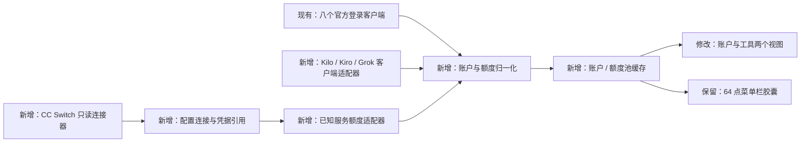
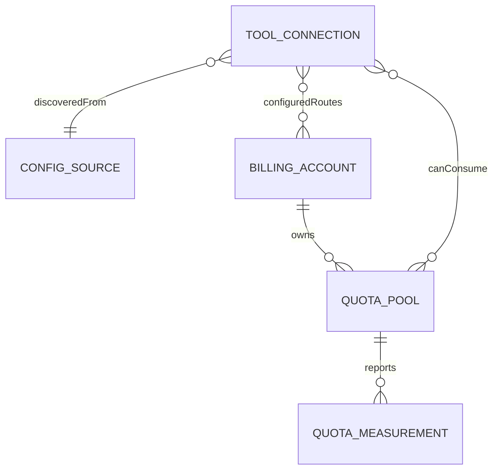

# QuotaNest：连接现有工具与统一额度账户

状态：设计草案，待产品评审；2026-10-23。基线 v1.7.1。DeepSeek 余额探针已通过真实账号验证；新增适配器尚未实现，其他平台保持各自未验证边界。

核心变更：从“一个工具对应一个额度”改为“工具连接到计费账户，账户拥有一个或多个额度池”。CC Switch 负责接入配置，QuotaNest 负责看清额度归属、余额与更新时间。

## 1. 背景——需求背景

用户已确认：不提供手动 Key 输入；优先识别 CC Switch 配置的 API 服务，包含中国 DeepSeek、GLM、Kimi，并纳入 xAI 的 Grok / Grok Bot、Kilo Pass 和 Kiro。外观采用接近苹果 Liquid Glass 的设计。继续使用原生 macOS Swift/AppKit，保留 64 点菜单栏胶囊与一分钟刷新。

当前 `QuotaProviderID` 固定八个平台，`ProviderReading` 按平台存状态，`QuotaWindow` 主要表示已用百分比。这适合官方套餐，无法准确表示“Claude Code 调用第三方 API”“多个工具共享钱包”“付费与赠送余额到期规则不同”。

## 2. 目标——业务目标、技术目标

- 用户打开菜单，能回答：我正在查看谁的额度、供哪些工具使用、还有多少、什么时候更新。
- 已有 CC Switch 用户无需再次填写 Key；首次主动选择连接来源与账户，其后只读同步。
- 同一已确认额度池每轮只查询一次；无法证明共享时保留分开，不猜测合并。
- 百分比、金额、credits、调用次数分别展示；未知余额不显示为 0、100% 或无限。
- 首版保持本地工具定位；不增加云后端、模型转发、自动切换模型或第三方脚本运行器。

## 3. 需求分析

| 编号 | 模块 | 场景 | 功能及规则 | 验收条件 |
| --- | --- | --- | --- | --- |
| R1 | 连接来源 | 已安装 CC Switch | 点击“连接已有工具”，展示发现的配置与读取范围，选择要显示的账户；不展示完整凭据 | 无 Key 输入框；不改 CC Switch 文件或当前配置 |
| R2 | 账户 | 多个工具共用钱包 | 一个账户卡片列出所服务工具；额度池按明确的账户/组织/预算范围去重 | 两个工具引用同一池时只发一次查询 |
| R3 | 工具 | Claude / Codex 接第三方 | “工具”页展示配置路由与数据来源，含 Direct / Routing / Aggregation；没有运行证据时标“已配置” | 不把本地代理地址当服务商，不把已配置当当前会话正在使用 |
| R4 | 额度 | 金额、套餐与多余额 | 显示各自单位、周期、到期日及真实层级；卡片主指标可固定到菜单栏 | 无总量的钱包显示金额，不生成百分比进度 |
| R5 | 新平台 | Kilo / Kiro / Grok | 经独立适配器读取已有登录与受支持的查询能力 | 接入识别与额度可查分别标状态；真实账号验收前标实验 |
| R6 | 状态 | 无余额接口、无权限、过期 | 分别显示“仅识别配置”“查询权限不足”“上次成功 + 时间”“需要原工具重新登录” | 不因不支持查询反复显示网络错误 `!` |
| R7 | 同步 | CC Switch 切换或多账户 | 连接标识与配置版本变化后重新解析；旧查询结果不得覆盖新连接 | 切换 A→B 后 A 的延迟返回不写入 B |
| R8 | 国内 API | DeepSeek / GLM / Kimi 经 Claude 或 Codex 使用 | 区分官方按量钱包、Coding 套餐及第三方转售账户 | 服务商、区域、产品与余额归属明确；不从模型名或 Key 前缀猜测 |
| R9 | 外观 | 当前胶囊外观调整 | 玻璃容器、稳定读数、轻量进度，系统能力决定原生或兼容材质 | 64 点宽；深浅背景、减少透明度与动态效果均可读 |

待产品确认事项：

| 编号 | 出处 | 问题 | 影响 | 当前建议 | 状态 |
| --- | --- | --- | --- | --- | --- |
| C1 | 本轮对话 | 是否手动添加 Key | 产品入口、凭据管理 | 不添加，复用已有配置 | 用户已确认 |
| C2 | 本轮对话 | grokbot 指代 | 平台范围 | xAI Grok / Grok Bot，区分产品与计费池 | 用户已确认 |
| C3 | 工程排期 | 可投入人数和开始时间 | 日历排期 | 以下给工作量区间；按一名全职工程师作参考，不承诺日期 | 待资源确认，不阻塞设计 |

## 4. 详细设计

### 4.1 架构与领域

只引入五种数据对象，字段见[字段契约](../../contracts/connected-accounts.md)。模型厂商、模型名是连接/用量上的元数据，不作为余额归属主键；自动路由的真实模型未知时就显示“自动路由”。

- `ConfigSource`：CC Switch 或官方客户端，含版本、路径引用与兼容性。
- `ToolConnection`：工具、profile、配置模式、配置服务与可选最近观测；Aggregation 是多条候选边，不假设一个全局当前服务。
- `BillingAccount`：服务商下的个人/组织/项目身份。不同团队即使使用同一域名也分别记账。
- `QuotaPool`：共享计费范围；月度套餐、赠送积分、钱包、密钥预算可并存。账户与密钥预算不是同一池。
- `QuotaMeasurement`：真实值、单位、查询时间、来源时间、有效期、准确性与状态。`nil` 表示未知，禁止伪造为零。

去重只采用适配器返回的稳定账户/组织/池标识；或同一来源的同一连接引用。相同域名、名称、模型或 Key 前缀不足以合并。凭据指纹仅在本机用于识别同一授权，不作为账户相等的通用证明；暂无可靠 ID 的两项标记“可能重复”，排除全局求和。

### 4.2 CC Switch：复用配置，不争夺控制权

上游公开实现使用 SQLite 存 provider / app_type、配置与元数据，另有本机路由状态；不应仅解析 Claude / Codex 的 endpoint，因为 Routing / Aggregation 可能只暴露 loopback 和占位凭据。上游也已有余额查询模板和自定义脚本。[上游说明](https://github.com/farion1231/cc-switch)、[查询文档](https://github.com/farion1231/cc-switch/blob/main/docs/user-manual/en/2-providers/2.5-usage-query.md)、[数据库结构](https://raw.githubusercontent.com/farion1231/cc-switch/main/src-tauri/src/database/schema.rs)。

设计选择：

1. 使用 Swift 内置 SQLite C API 只读连接已兼容的数据库；默认位置与上游自定义位置按其设置解析。短读事务、busy timeout 200ms；发生忙锁保留前次解析，下一轮再试，不进行迁移或写入。
2. 最小投影读取已选连接及对应查询配置，不扫描聊天记录、命令历史或整个进程环境。不读取 shell 脚本来执行求值，不执行 `apiKeyHelper`。
3. 首次列出账户后由用户选择连接。查询时在内存解析已有凭据，身份对象只持引用；不另存 Key，不在诊断、导出、示例或界面中输出。来源删除后连接失效，不维持隐藏的凭据副本。
4. 内置适配器支持上游已识别的查询类型与字段，凭据只发往已确认的查询 origin；跨 origin 的余额地址首次单独展示目的地，不能自动把模型 Key 发送给它。HTTP 只允许 loopback；远端要求 HTTPS；拒绝携凭据的跨域重定向。
5. 首版不运行 CC Switch 的任意 JavaScript 查询脚本。能识别的内置查询类型由 Swift 实现；自定义/修改过的脚本仅标“请在 CC Switch 查看”。不能宣称已存在通用的上游只读余额缓存或本地导出 API；本次未验证有这样的契约。
6. 上游 schema 超出兼容范围时停用该连接器并提示版本不兼容；八个原有平台继续工作。先记录支持的实测版本和 fixture，再扩版本范围。

读取允许并不等于所有服务都能查余额：推理 Key、管理 Key、站点 access token 的权限可能不同。已有凭据权限不足时回原工具配置，不提供本工具 Key 输入入口。[OpenRouter credits 接口要求 management key](https://openrouter.ai/docs/api/api-reference/credits/get-credits)；普通 Key 的[查询接口](https://openrouter.ai/docs/api/api-reference/api-keys/get-current-api-key)可表示 Key 自身用量和预算，不等同全账户钱包。

### 4.3 新平台接入矩阵

| 对象 | 展示方式 | 拟使用来源 | 本次核实与待验证 |
| --- | --- | --- | --- |
| CC Switch 配置的 API 服务 | 实际计费服务名称，副标题“来自 CC Switch · 用于 Claude Code / Codex” | 上游配置 + 已知余额适配器 | 配置结构可研究；每种查询权限需单独实测，不承诺通用余额 API |
| DeepSeek 官方 API | CNY / USD 可用余额，展开显示充值与赠送余额 | CC Switch 中已有官方服务凭据 | 已用本机已有 Claude→DeepSeek 配置调用官方余额接口成功；不表示原生应用已接入 |
| GLM / BigModel API | 按量钱包与 GLM Coding Plan 分开 | CC Switch 连接的明确产品配置；原 ZCode 官方登录路径保留 | 当前只确认既有 ZCode 个人套餐适配证据，API 凭据的查询能力与按量钱包端点仍待验证；不把它直接当成 ZCode 登录 |
| Kimi / Moonshot API | API 可用余额、现金与代金券；Kimi Code 套餐另列 | CC Switch 已有开放平台凭据；原 Kimi Code 登录单独复用 | 国内 API 余额契约有官方文档，真实账号待验收；国内与国际平台分别识别，不混用 Key 或币种 |
| Kilo Pass | Kilo 账户，付费余额与赠送余额分池，标到期日 | 已有 Kilo 官方登录或 CC Switch 中已有 Kilo 服务配置 | 官方说明余额跨产品使用、奖励有到期规则；余额读取契约仍需技术探针与账号验收，不使用猜测 URL |
| Kilo BYOK | 将已知消耗关系指向上游账户；无法确认则只展示“由上游计费” | 已有连接和官方计费信息 | Kilo 侧 $0 不代表上游免费，不把 Kilo 钱包当这条连接的可用额度 |
| Kiro | 月 credits + 加量包，分开到期与范围 | 优先官方 CLI 已登录的 ACP 查询能力 | V3 文档有需协商的 `_kiro/account/getUsage`；先验证能力与返回值。不同 CLI 代际分开兼容，不把旧 `/usage` 上下文占用误当账单 |
| Grok / Grok Bot | 以接口返回的独立或共享额度池展示，附适用产品 | 官方客户端已有登录，或 CC Switch 已有 xAI 授权 | 公共说明存在发布时间与共享范围差异；尚未验证稳定查询契约，先实验探针，不能写死 Bot 与 Grok 必定共享/独立，更不能与 xAI API 钱包混合 |

事实来源：[Kilo Pass](https://kilo.ai/pricing/kilo-pass)、[Kilo BYOK 计费](https://kilo.ai/docs/gateway/usage-and-billing)、[Kiro ACP V3](https://kiro.dev/docs/cli/v3/acp-migration/)、[Kiro FAQ](https://kiro.dev/faq/)、[Grok Bot 发布说明](https://x.ai/news/introducing-grok-bot)、[Grok 当前 FAQ](https://docs.x.ai/grok/faq)。这些资料证明产品规则或候选接入方式，不证明 QuotaNest 已能查询。

国内 API 依据：[DeepSeek 余额契约](https://api-docs.deepseek.com/api/get-user-balance/)、[Kimi 国内 API 余额契约](https://platform.kimi.com/docs/api/balance)、[GLM Coding Plan](https://docs.bigmodel.cn/cn/coding-plan/overview)。项目原有官方登录边界见 [Kimi Code](../../providers/kimi.md)、[ZCode / BigModel](../../providers/china-login.md)。OpenRouter 等服务转售 DeepSeek / GLM / Kimi 模型时，归属仍是所使用的服务账户，不能拿转售 Key 去请求模型厂商余额。

2026-10-23 12:09（Asia/Shanghai）真实探针：只读 CC Switch 内已有 Claude DeepSeek 连接，确认 origin 为 `https://api.deepseek.com`，以现有凭据 GET `/user/balance`，HTTP 200、约 0.2 秒，解析到 CNY 的 total / granted / topped-up 三项。未发起推理请求，未修改配置或存储凭据。用户真实金额不写入仓库。该机器存在不一致的默认项与路由记录，因此不能仅凭某个 is_current 字段宣称当前所有 Claude 会话都使用 DeepSeek。

DeepSeek 的官方 total 是充值与赠送的合计，展示时总额与组成项不能重复求和。Kimi 的 available/cash/voucher 也保留原始含义，cash 可以为负；按官方可用余额展示，不能一律截零或简单重算。API 钱包与 Coding 套餐是不同指标；同一主体的关联必须由身份与产品证据建立。

### 4.4 交互与视觉

菜单栏继续只占 64 点，固定一个“账户 + 指标”，不轮播、不增加一排品牌。支持两种呈现：可计算的额度比例沿用进度胶囊；只有钱包金额时显示带币种的短金额，取消比例填充，完整值放详情中。长金额采用明确缩写，不静默截断或换币。

弹窗建议宽 380 点，保留系统字体、平台标识、低饱和强调色，分“账户 / 工具”两页：

- **账户（默认）**：仅显示用户连接的账户，置顶固定项；每行显示余额/余量、周期、更新状态。点击展开明细、额度池范围、服务工具和来源；不在列表强迫用户读配置术语。
- **工具**：如“Claude Code → 工作 API → 自动路由（已配置）”。路由失败切换或会话环境覆盖不可见时明确未知；不声称本工具掌握每个会话的实际路径。
- **连接已有工具**：选择“CC Switch / 官方客户端”→ 发现列表 → 勾选账户 → 查看读取范围与查询目的地 → 完成。没有 Key 输入、重新填 base URL 或脚本编辑器。
- 详情页“固定到菜单栏”是主动操作；CC Switch 切换不偷偷改固定项。已固定的池消失时显示“来源已移除”，引导选其他账户。
- 金额直接显示 `USD 18.20` / `CNY 86.00`；credits 显示 `480 / 1,000`；百分比必须有同一池的分母。绝不求所有账户平均百分比，也不把不同币种与 credits 相加。
- 未支持：`已识别 · 暂不支持查余额`；缺权限：`已连接 · 查询权限不足`；过期：`上次 USD 18.20 · 8 分钟前`。`!` 留给已支持查询的失败或明确过期，不把缺功能伪装成服务故障。
- 保留键盘导航、VoiceOver 名称，文字同时说明状态，不仅靠颜色；刷新时不跳动列表或抢焦点。
- 原生弹窗高度不超过可用屏幕高度减 80 点；账户多时列表滚动，固定页头与底部操作，不能让额度明细或连接入口落到屏幕外。

交互草图是独立 HTML，使用虚构数据，不连接本机账户、不执行真实查询；未修改原生应用 UI。UI 技能检索返回的网页营销布局不适用于菜单栏应用，采用项目现有 AppKit 风格与系统交互作为设计依据。

玻璃外观采用单一方向：胶囊去掉大块纯黑底，改为透明材质、细轮廓与顶部轻高光；比例仍由左侧低饱和填充宽度表达，金额模式不画虚假进度。品牌标识、读数、周期按钮维持原有位置和点击范围。弹窗外壳与分段导航使用玻璃，账户数据区使用更实的中性底，避免层层叠加模糊；悬停/切换约 120–180ms，不做持续闪光或循环流动。

实现采用公开 AppKit API：macOS 26+ 在支持的容器采用 `NSGlassEffectView` 并继承后续系统更新；旧系统以 `NSVisualEffectView` 和克制的边缘高光实现兼容外观。当前实机为 macOS 15.7.7，不能验收原生 Liquid Glass；HTML 草图只是视觉模拟。降低透明度/增强对比度时切为较实背景，减少动态效果时取消装饰动画。菜单栏内的原生玻璃层级需独立 spike，不能用私有 API 或改变系统设置凑效果。[Apple 材质规范](https://developer.apple.com/design/human-interface-guidelines/materials)、[NSGlassEffectView](https://developer.apple.com/documentation/appkit/nsglasseffectview)、[NSVisualEffectView](https://developer.apple.com/documentation/appkit/nsvisualeffectview)、[macOS 27 AppKit 更新](https://developer.apple.com/videos/play/wwdc2026/289/)。

### 4.5 刷新与兼容迁移

沿用一分钟调度：只对用户启用的额度池查询，按池合并并发，最大并发 2；每次预算不超过 30 秒，瞬态错误最多重试一次，429 按 Retry-After 跳过后续轮次。Kiro 官方用量约五分钟更新一次，界面仍一分钟触发检查，分别记录查询时间与来源时间，不把成功 HTTP 请求标成用量实时变化。

每次查询带 connection generation；配置变更后旧代返回丢弃。UI 切换只读缓存，不额外发一轮请求；手动刷新复用同一个 in-flight。适配器不支持的操作不会每分钟反复探测。

原有八客户端和 `QuotaSnapshot` 保留，通过转换器接入新模型，先处理 Codex / Claude 与 CC Switch 的绑定，再迁移其他展示。仅已有快照、无明确账号 ID 的旧项保留为独立本地连接，不能自动声称它与 CC Switch 的账户相同。原 selectedProvider / quotaPeriod 首次转换为固定项和对应指标；未能匹配则保留原平台展示。新缓存单独存储，旧偏好不删除；停用连接器即可回到八个平台，未写入任何外部配置。

## 5. 接口设计

不新增云服务或虚构统一 balance URL。内部方法与 DTO 的完整契约见[字段契约](../../contracts/connected-accounts.md)。

| 类型 | 用途 | URL / 方法 | 请求形式 | 变更 | 备注 |
| --- | --- | --- | --- | --- | --- |
| 内部 | 发现可连接来源 | `SourceConnector.discover()` | Swift 调用 | 新增 | 返回脱敏描述，不返回凭据 |
| 内部 | 同步连接状态 | `SourceConnector.resolve(reference)` | Swift 调用 | 新增 | 只读配置，返回 generation 与凭据引用 |
| 内部 | 查询额度池 | `QuotaAdapter.fetch(context)` | Swift 异步调用 | 新增 | 固定适配器决定 endpoint、鉴权与解析 |
| 内部 | 兼容八平台 | `LegacyQuotaMapper.map(snapshot, context)` | Swift 调用 | 新增 | 不改变原客户端登录流程 |
| 上游 | CC Switch 配置 | SQLite 只读事务 + 已知本机状态文件 | 非 HTTP | 新接入 | 上游数据库不属于本项目 API，按实测版本兼容 |
| 上游 | OpenRouter Key 指标 | `GET https://openrouter.ai/api/v1/key` | HTTPS；Bearer；无请求体 | 候选 | 仅用已有凭据；不推断全账户余额 |
| 上游 | DeepSeek 官方余额 | `GET https://api.deepseek.com/user/balance` | HTTPS；Bearer；无请求体 | 待实现，真实探针通过 | Claude 推理地址可能有 `/anthropic`，余额端点固定在官方根路径，不能拼成 `/anthropic/user/balance` |
| 上游 | Kimi 国内 API 余额 | `GET https://api.moonshot.cn/v1/users/me/balance` | HTTPS；Bearer；无请求体 | 文档确认，账号待验证 | 与 Kimi Code OAuth / coding endpoint 分开；按官方 amount 字段处理 |
| 上游 | GLM 按量余额 / API 方式套餐 | 端点及凭据权限待验证 | 待验证 | 探针 | 原有 ZCode OAuth 适配不能证明 API Key 查询可用 |
| 上游 | Kiro 账号用量 | 协商后 `_kiro/account/getUsage` | 官方 CLI ACP JSON-RPC | 候选 | 能力未声明则不调用；返回结构待探针 |
| 上游 | Kilo / Grok 余额 | 待核实，未命名 endpoint | 待核实 | 探针 | 先获得已有登录与可验证契约，再实现 |

## 6. 里程碑

工作日 D1 从实际启动后计算；以下按一名全职 macOS 工程师、AI 辅助开发估算，人员与起始日期未确认。阻塞平台独立交付，不拖住已验证的 CC Switch 核心。

| 阶段 | 交付与完成标准 | 开始 | 完成 | 依赖 | 假设 / 门槛 |
| --- | --- | --- | --- | --- | --- |
| 技术设计 | 模型、交互、来源契约与脱敏 fixture | D1 | D2–D3 | 本设计评审 | 首批验证 CC Switch 实际安装版本；Kilo/Grok 探针各限 1pd，失败记录缺口 |
| 后端开发（本地数据层） | CC Switch 只读连接器、去重、DeepSeek 与 Kimi API 额度适配 | D3 | D9–D13 | fixture 与已有查询权限 | 不提供任意脚本执行；不依赖新建管理 Key |
| 前端开发（AppKit） | 账户 / 工具弹窗、固定指标与玻璃兼容效果 | D10 | D14–D18 | 数据契约 | 同一工程师开发时串行；约 3–4pd UI 工作，不计入下章后端合计；新系统材质需对应实机验收 |
| QA 测试 | 真账户路由/余额核对、错误与升级验证 | D15 | D18–D22 | 本地可安装构建 | 真实账号由用户/测试者在原工具登录；QA 人力待确认 |
| 灰度 | 少量已有 CC Switch 用户验证至少两种工具与余额类型 | QA 通过后 | 2 个观察日 | schema 与查询类型通过验收 | 未验证平台继续标实验或不开放 |
| 正式上线 | 合并、通用 DMG、校验文件与稳定 Release | 灰度通过后 | 1 个发布日 | 用户明确发布指令 | 不自动发布本设计或未验证适配器 |

交付顺序：第一批 CC Switch + 原有账户正确归属 + DeepSeek 官方 API；Kimi API 在已有账号验证后并入，GLM 的按量钱包与 API 套餐先分别探针；第二批 Kiro（文档能力先验证）与 Kilo；第三批 Grok（以可证实的池与登录契约为准）。玻璃外观与数据层可独立验收，不等待全部新平台。

## 7. 工时

仅估算本地数据层、适配器与工程验证；1pd = 1 人一个标准工作日，非远端后端服务工作。下表按一名全职工程师作参考投入，实际资源待确认。

| 编号 | 本地后端事项 | 交付物 | pd | 参考投入 | 周期（工作日） | 依赖 | 具体不确定性 |
| --- | --- | --- | --- | --- | --- | --- | --- |
| E1 | CC Switch schema / 登录查询验证 | 钉住的兼容版本与脱敏 fixture | 1–1.5 | 1 人 / 100% | 1–1.5 | 现有安装与授权 | 上游版本可能不同于 main |
| E2 | 账户 / 池模型与旧平台转换 | 正确去重、状态与偏好迁移 | 1.5–2 | 同上 | 1.5–2 | E1 可部分并行设计 | 缺稳定 ID 的账户保留独立 |
| E3 | CC Switch 只读与已知查询适配 | 连接发现、凭据引用、首批查询类型 | 2–3 | 同上 | 2–3 | E1、E2 | 自定义脚本不在首版 |
| E4 | 调度、代际隔离与缓存 | 并发/失效/取消回归 | 0.5–1 | 同上 | 0.5–1 | E2、E3 | 切换中旧结果不得串写 |
| E5 | 数据层自测、联调与修复 | fixture + 真账户验收证据 | 1–1.5 | 同上 | 1–1.5 | E3、E4 | 无余额权限时不能写成支持 |
| E8 | 国内 API 余额适配 | DeepSeek 与 Kimi API 字段映射、范围与组成项验收 | 1–2 | 同上 | 1–2 | E1–E3、已有账号 | DeepSeek 真实探针已通过；Kimi 无账号时仅交文档/fixture，不宣称实测 |
| 合计 | 第一批核心 | 不含 UI、QA 独立工作与观察日 | **7–11** | 参考 1 人 | **7–11** | 串行主链 | 全流程约 4–5 周，资源确认后再排日历 |
| E6 | GLM、Kiro、Kilo、Grok 分别探针 | 每家证据与是否可接入结论 | 每家 0.5–1 | 同上 | 分别安排 | 已有账号配置/官方登录 | 探针不等于接入完成 |
| E7 | 已证明可用的单平台适配 | 登录复用、解析、真账户回归 | 每家另 1.5–3 | 同上 | 依平台排序 | 对应 E6 通过 | 无稳定查询能力则不进入实现 |

设计评审通过后再拆实施计划；本轮仅完成设计与用户明确授权的 DeepSeek 余额读取，不修改凭据、原工具配置、已安装应用或发布版本。
